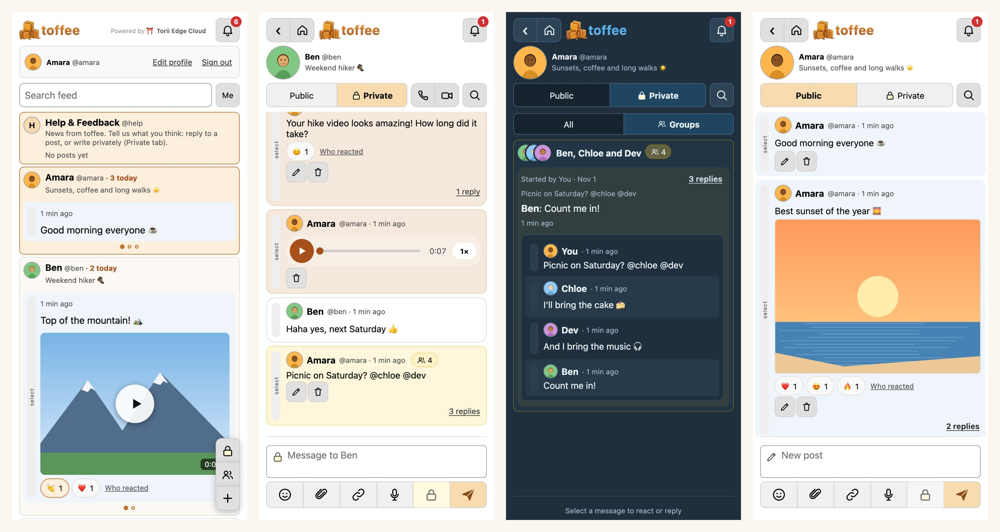

<p align="center"></p>

<h1 align="center">toffee</h1>

<p align="center">Share photos, videos, voice notes and documents with friends.</p>

**Use it: [braincandy-toffee.torii-edge-cloud.duckdns.org](https://braincandy-toffee.torii-edge-cloud.duckdns.org/)**
(on a phone, add it to your Home Screen and it works like an app)

toffee is a small, calm social and chat app. Everyone has their own channel. You post there,
talk privately, start one-off groups, and call people, all from the browser. It installs like
an app (PWA) and needs no app store.

- **No email or phone number:** a username and a password, plus a recovery key you keep.
- **No Google, no trackers, no CDN:** everything is served by toffee itself.
- **Light:** plain PHP and plain JavaScript, one SQLite file, no build step.

## What it does

| | |
|---|---|
| **Home feed** | Everyone's channel, with their latest posts. Today's posts swipe sideways |
| **Your channel** | Public posts, with replies and reactions |
| **Private chats** | Between two people, with replies, reactions, photos, files |
| **One-off groups** | A private message that @names others starts a group; @name someone in a reply to bring them in |
| **Voice notes and videos** | Nothing loads until you press ▶; lengths and covers show at once |
| **Calls** | Voice and video, phone to phone (WebRTC); group calls; add people to a call |
| **Phone notifications** | Web Push, also for calls (they ring) |
| **Fast on slow phones** | What you've seen is kept on the phone and opens at once; your messages show the moment you send |
| **Themes** | 9 themes, light and dark; pick the font and text size |



*Home, a private chat with a voice note, a one-off group (dark theme), and a channel. Made-up people and pictures.*

How it works inside, with diagrams: [docs/ARCHITECTURE.md](docs/ARCHITECTURE.md).

## Run it on your computer

You need **PHP 8.2 or newer** with `pdo_sqlite`, `openssl`, `curl`, `fileinfo`, `mbstring` and `zlib`.

```sh
git clone https://github.com/MohlomiCliffMakhetha/toffee.git
cd toffee
mkdir -p /tmp/toffee-data
TOFFEE_DATA=/tmp/toffee-data php -d upload_max_filesize=55M -d post_max_size=60M -S 127.0.0.1:8099 -t . router.php
```

This runs your own copy, on your computer only. Open http://127.0.0.1:8099 and create a profile. The database (`toffee.db`) and uploads go in
`TOFFEE_DATA`. Calls and phone notifications need `https` (or `localhost`).

Run the tests:

```sh
php tests/api_test.php        # the whole API: ~280 checks
php tests/replica_test.php    # a writer and a read copy (needs: brew install garage)
```

## Run it on Torii Edge Cloud

toffee is made for [Torii Edge Cloud](https://torii-edge-cloud.duckdns.org): Raspberry Pis, with
Traefik as the front door. Push the repo to your Torii app, and Torii builds it with
`.torii.Dockerfile` (php -S with 10 workers).

`.torii.yml`:

```yaml
memory: 512
# The database, uploads and sign-ins in /data are kept in Torii's storage (Garage),
# so toffee starts on any Pi if the one it runs on fails.
data: replicated
db_path: /data/toffee.db
```

With `data: replicated`, Torii runs a **writer** copy and **read copies** on other Pis, and
keeps files in Garage (S3). toffee follows the rules for that: a GET never writes, and only the
writer upgrades tables or sends notifications. More in [DATA.md](DATA.md).

### Settings (environment)

| Setting | What it's for |
|---|---|
| `TOFFEE_DATA` | Folder for the database and files (default `/data`) |
| `TORII_ROLE` | `writer` or `reader` (set by Torii) |
| `TORII_S3_ENDPOINT`, `TORII_S3_REGION`, `TORII_S3_BUCKET`, `TORII_S3_ACCESS_KEY_ID`, `TORII_S3_SECRET_ACCESS_KEY` | Where files go (set by Torii). Not set: files go in `TOFFEE_DATA/uploads` |
| `TORII_FILES_URL` | The public address of the files bucket (set by Torii) |
| `TOFFEE_STUN` | STUN servers for calls (default: Cloudflare's) |
| `TOFFEE_TURN_URLS`, `TOFFEE_TURN_SECRET` | A TURN relay for calls on networks that block direct links (optional) |

### The Help & Feedback channel

toffee makes a channel called **help** the first time it starts. Its first password is set by
`HELP_PASS_HASH` in `api.php`, and that hash is public. **If you run your own toffee, give `help`
its own password straight away:**

1. Before the first start: replace `HELP_PASS_HASH` with your own (`php -r 'echo password_hash("your password", PASSWORD_DEFAULT);'`).
2. Or after: sign in as `help`, save the recovery key toffee shows you, sign out, then use
   **Forgot password?** with that key to set a new password.

## Licence

MIT licence: see [LICENSE](LICENSE).
