# How toffee works

toffee is a small social and chat app. People post on their own channel, talk privately, make
one-off groups, send photos, videos and voice notes, and call each other.

This page shows how it is built: the parts, the files, the data, and what happens step by step.

---

## 1. The tools (no big framework)

| Part | What it is | Why |
|---|---|---|
| Server code | **PHP 8.2**, plain (no framework) | Small, fast to start on a Raspberry Pi |
| Web server | **`php -S`** (PHP's own server) with **10 workers** | Nothing else to install or look after |
| Database | **SQLite** (one file), WAL mode | No database server; reads never block |
| Phone/browser code | **Plain JavaScript** (no React, no build step) | Loads fast, nothing to compile |
| Look | **One CSS file**, 9 themes (CSS variables) | Light and simple |
| Installable app | **PWA** (manifest + service worker) | Add to Home Screen; no app store |
| Phone notifications | **Web Push** (written in-house: `webpush.php`) | No Google or other company in between |
| Calls | **WebRTC**, phone to phone | The sound and picture never go through the Pi |
| Files | **Garage** (S3-compatible storage on Torii) | Photos and videos served from any Pi |
| Hosting | **Torii Edge Cloud**: Raspberry Pis, **Traefik** front door | Several copies of toffee run at once |
| Emoji picker | **picmo** (self-hosted in `vendor/`) | No CDN at runtime |

---

## 2. The big picture (block diagram)

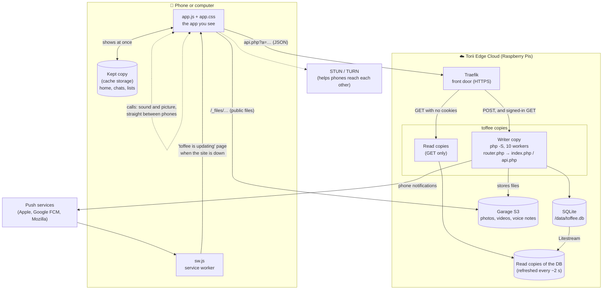

**In one sentence:** the phone shows what it already has straight away, talks to `api.php` for
everything else, and phones in a call talk straight to each other.

---

## 3. The files (project structure)

```
Toffee/
├── index.php            The one web page. Loads app.css and app.js, the logo, the link preview
├── app.js               The whole app in the browser (one file, plain JavaScript)
├── app.css              The whole look: layout, 9 themes, every screen
├── api.php              The whole server: every action (?a=…), the database, the rules
├── router.php           php -S router: hides private files, serves static files fast (gzip, cache)
├── sw.js                Service worker: install, phone notifications, "updating" page, emoji cache
├── updating.html        "toffee is updating" page, kept on the phone for when the site is down
├── webpush.php          Sends phone notifications (Web Push, encrypted, signed with VAPID)
├── s3.php               Talks to Garage (S3): upload, download, delete files (signed requests)
├── gz_name.php          Where the gzipped copy of a file lives (used by router.php and precompress)
├── manifest.json        Makes toffee installable: name, colours, icons
├── icon-*.png, toffee.png, favicon-32.png, badge-96.png, og-image.png, toffee-logo*.png/.webp
│                        App icons, link-preview picture, logo
├── vendor/              Other people's code, pinned and self-hosted (no CDN)
│   ├── picmo-5.8.5/            the emoji picker
│   ├── emojibase-data-17.0.0/  emoji names and pictures for search
│   ├── roboto/, gelasio/       font files (the Roboto and Georgia choices)
│   └── README.txt              where each came from, and its licence
├── tools/
│   ├── precompress.php          Gzips the text files once when the app is built (never from the web)
│   └── move-uploads-to-s3.php   One-off: moves old files from /data/uploads into Garage
├── tests/
│   ├── api_test.php        ~280 checks of the whole API (privacy, groups, calls, uploads…)
│   ├── replica_test.php    A writer and a read copy with a local Garage: reads write nothing
│   ├── lib.php             Test helpers (a test browser, start a toffee server)
│   └── voice-quicktime.mov A tiny iPhone-style voice note for the upload test
├── docs/                Notes (not part of the site): this page, who-can-do-what, Torii needs
├── DATA.md              Where data lives and how several copies work
├── .torii.yml           Tells Torii: replicated data, database path, memory
├── .torii.Dockerfile    How the app image is built and started (php -S, 10 workers, opcache)
├── .dockerignore        Kept out of the image: .git, tests, docs, notes
└── .gitignore           Not saved in git: .gz/, test leftovers
```

### Who does what, in short

| File | Runs on | Its job |
|---|---|---|
| `index.php` | Server, once per visit | Sends the page; starts asking "who's signed in" before app.js arrives |
| `app.js` | Phone | Every screen, every button, polling, calls, recording, the kept copy |
| `app.css` | Phone | Every look, light and dark themes |
| `api.php` | Server | Every rule: who may see what, posting, groups, calls, files, notifications |
| `router.php` | Server | First stop for every request: hide, serve static, or hand to PHP |
| `sw.js` | Phone (in the background) | Notifications while closed, the "updating" page, emoji cache |
| `webpush.php` | Server | Builds and sends encrypted phone notifications |
| `s3.php` | Server | Files in Garage |

---

## 4. Inside app.js (the phone side)

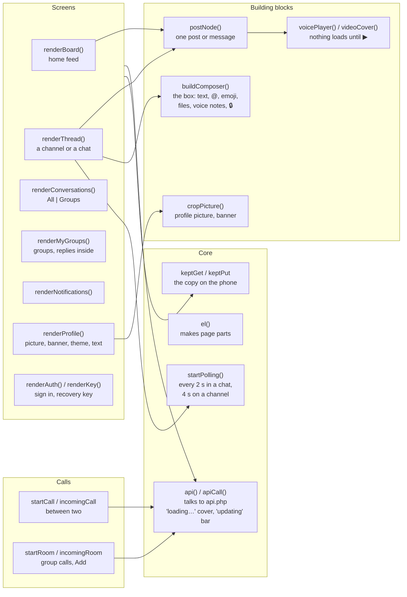

---

## 5. Inside api.php (the server side)

One request comes in as `api.php?a=ACTION`. The file:

1. Opens the database (`/data/toffee.db`). **Read copies** open it read-only.
2. Upgrades the tables if needed (writer only, once): **schema version 11**.
3. Finds who's signed in from the signed cookie (`tf_auth`) and checks the CSRF token on POSTs.
4. Runs the action (a big `switch`), and answers JSON.
5. Work that can wait (phone notifications, deleting files from Garage) runs **after** the answer is sent.

### The actions

| Group | Actions |
|---|---|
| Sign in | `me` `register` `login` `logout` `recover` `recovery_new` `delete_account` |
| Profile | `profile` `background` |
| Reading | `channels` (home) `thread` (a channel or a chat) `conversations` (All) `my_groups` `group_thread` `notifications` `reactions` `latest` (the quick check) |
| Writing | `post` `edit_post` `delete_post` `react` `conversation_read` `notifications_read` `notifications_clear` |
| Files | `upload` `file` `library` `resolve_link` |
| Phone notifications | `push_key` `push_subscribe` `push_resubscribe` `push_unsubscribe` `push_test` |
| Calls between two | `call_config` `call_start` `call_ring` `call_poll` `call_answer` `call_alive` `call_end` |
| Group calls | `room_start` `room_from_call` `room_add` `room_state` `room_join` `room_offer` `room_answer` `room_alive` `room_leave` |

**Golden rule:** a GET never writes. Read copies can answer any GET.

---

## 6. The data (database tables)

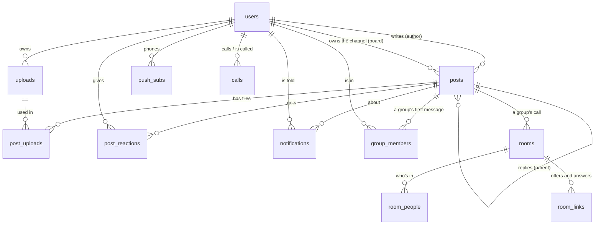

| Table | What's in it |
|---|---|
| `users` | Username, password hash, name, bio, picture, banner, recovery-key hash, session number |
| `posts` | Every post, reply and private message. `is_private`, `recipient_id`, `parent_id` (a reply), `group_id` (a group's message) |
| `uploads` | Every file: who owns it, kind (image, video, audio…), size, length, cover picture |
| `post_uploads` | Which files are on which post |
| `post_reactions` | Who reacted with which emoji |
| `notifications` | Who is told about what (🔔), read or not |
| `group_members` | Who's in each one-off group, and whose chat it shows in |
| `push_subs` | Each phone that gets notifications |
| `calls` | Calls between two: ringing, answered, ended (and the setup offer and answer) |
| `rooms`, `room_people`, `room_links` | Group calls: who's in, and each pair's offer and answer |
| `settings` | Keys (cookie signing, push keys) and the home feed's change counter |
| `signed_out`, `throttle` | Signed-out sessions; rate limits (sign-in tries, new profiles) |

---

## 7. Step by step (sequence diagrams)

### 7.1 Opening toffee

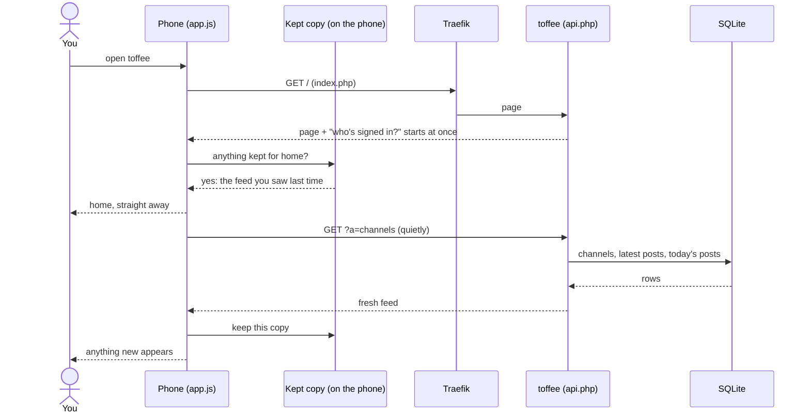

### 7.2 Sending a message (it shows at once)

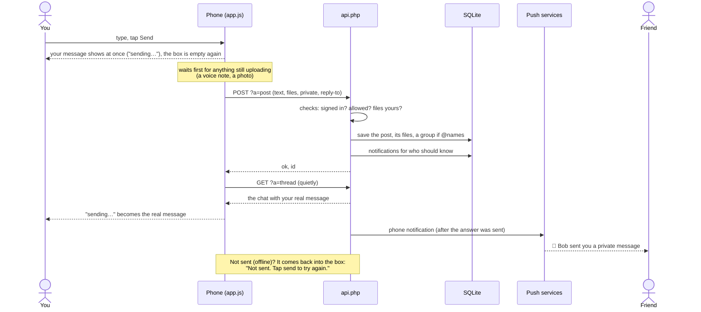

### 7.3 New messages arriving (the quick check)

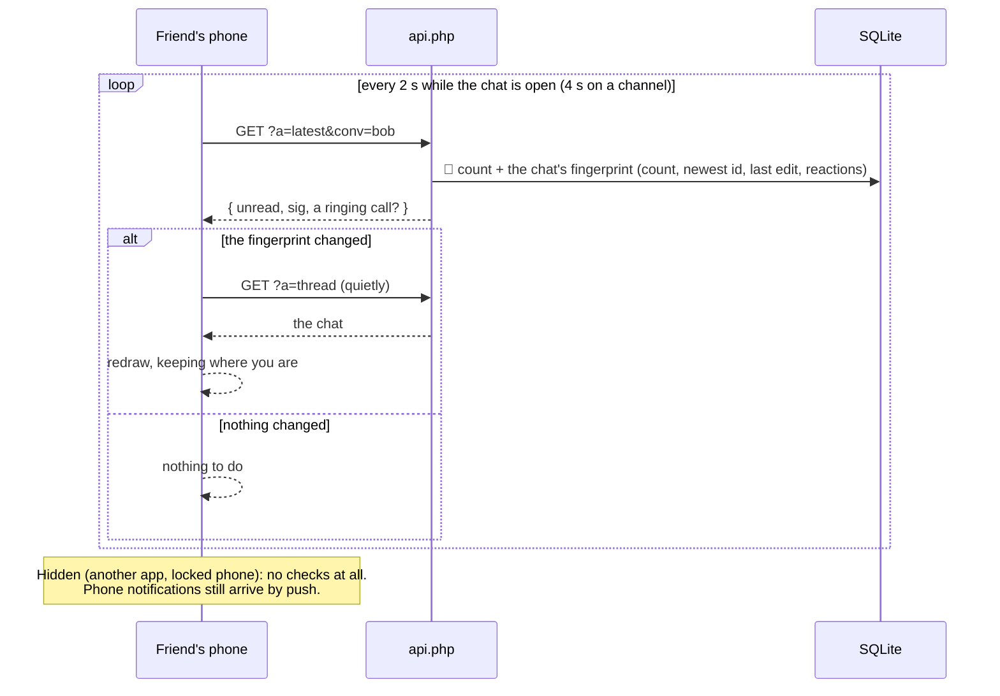

### 7.4 A voice note

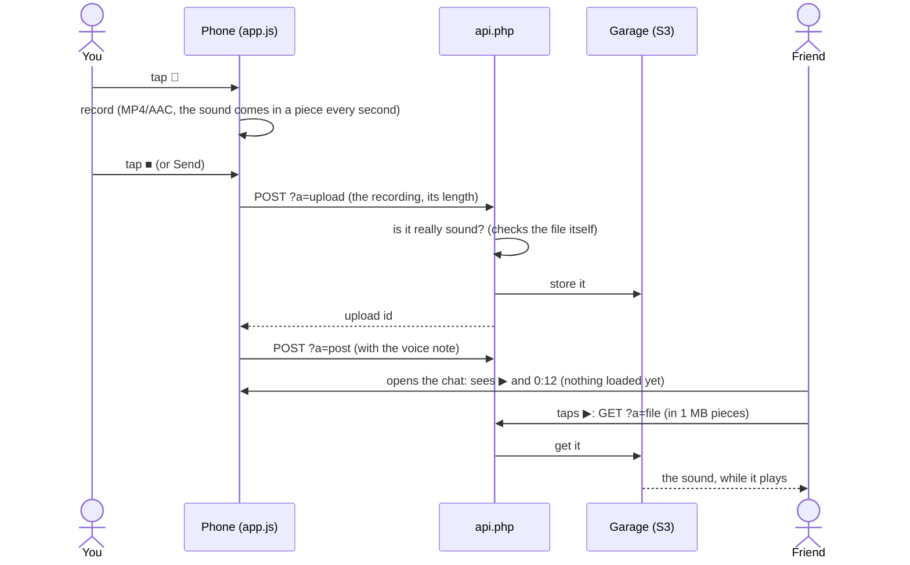

### 7.5 A one-off group

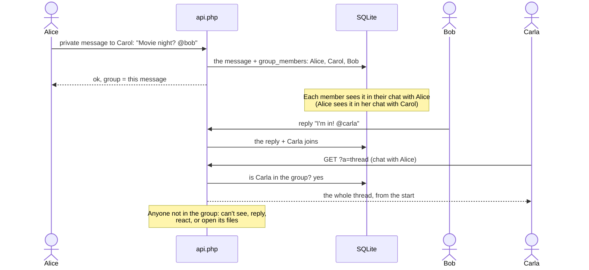

### 7.6 A group call (each phone to every other)

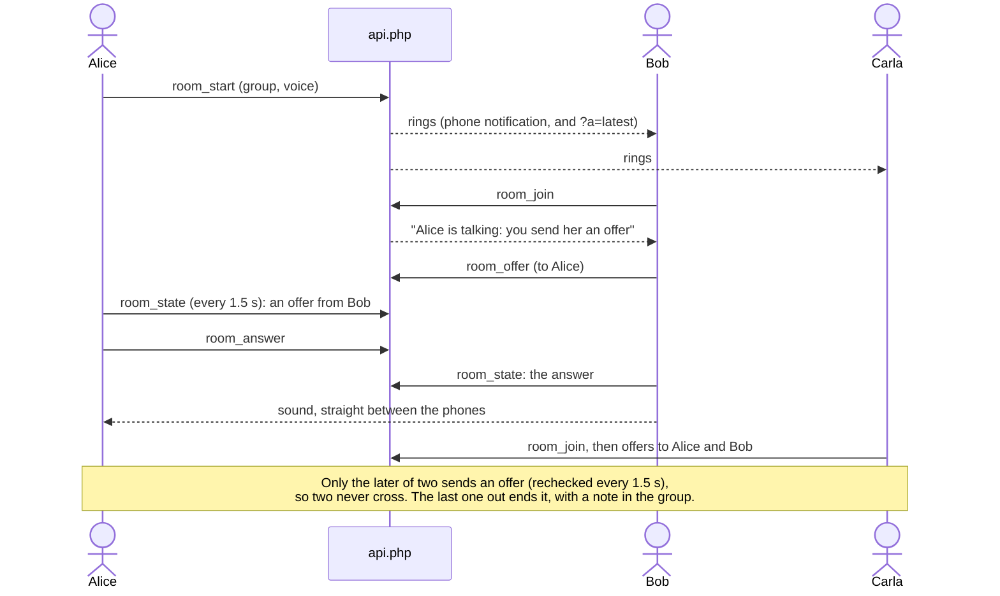

### 7.7 When toffee is down for a deploy

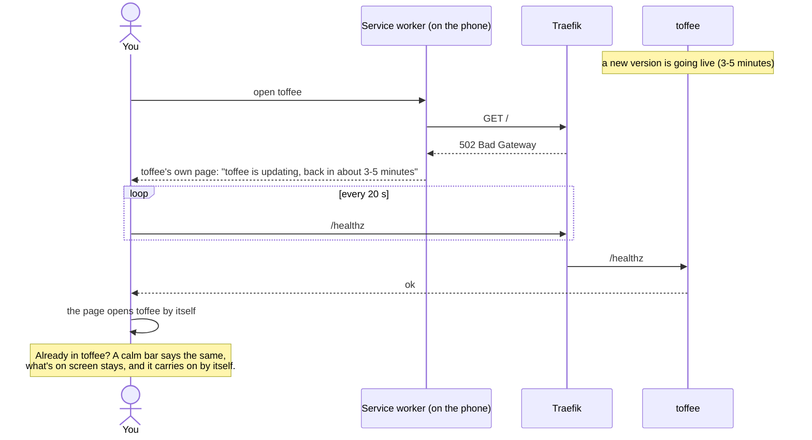

### 7.8 A phone notification while toffee is closed

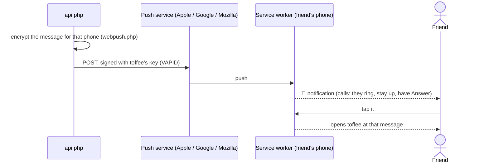

---

## 8. Safety rules (where they live)

| Rule | Where |
|---|---|
| Signed cookie, CSRF token on every POST | `api.php`, top |
| Who may see a post (`can_see`): public, or author/recipient, or group member | `api.php`, `can_see()` and `pair_sql()` |
| Files follow their post (private files only to those allowed) | `api.php`, `case 'file'` |
| Uploads: type checked by content, size caps per kind, no programs | `api.php`, `case 'upload'` |
| Rate limits (sign-in tries, new profiles) | `api.php`, `throttle()` |
| Hidden files (.git, tests, tools…) and `//` tricks refused | `router.php` |
| No script in user text (only `textContent`; links must be http/https) | `app.js`, `el()` and `renderMarkdown()` |
| Phone notification keys checked; one bad phone can't stop the rest | `api.php`, `webpush.php` |

---

## 9. Tests

| Test | What it proves | Run |
|---|---|---|
| `tests/api_test.php` | ~280 checks: sign-in, privacy, groups, calls, uploads, notifications, speed rules | `php tests/api_test.php` |
| `tests/replica_test.php` | A writer and a read copy, with files in a local Garage; reads write nothing | `php tests/replica_test.php` (needs `brew install garage`) |
| Browser checks (outside the repo, `~/toffee-browser-tests`) | Real Chrome: every screen, calls with fake cameras, slow networks, outages | `node <test>.js` |
